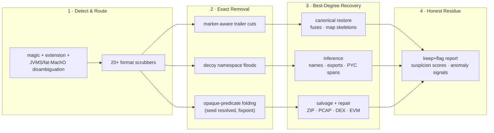

<div align="center">


# BLADE: Bypass LLM Agent Defense Engine

### **Cut → Recover → Restore. Make Reverse Engineering Cheap Again.**

**The open-source Counter-BLA de-hardening pipeline that strips `bla-agents` defenses from protected artifacts before analysis — so `morluto/rea`, decompilers, and LLM recon pipelines see real logic instead of decoys.**

[](#-format--defense-coverage)
[](#-empirical-results-vs-bla)
[](#-adversarial-fixture-standings)
[](#-30-second-quick-start)
[](LICENSE)

[Quick Start](#-30-second-quick-start) · [How It Works](#-how-blade-works-adaptive-not-more-tools) · [Feature Matrix](#-feature-matrix-by-defense-family) · [Format Coverage](#-format--defense-coverage) · [Recovery Engines](#-best-degree-recovery-engines) · [Empirical Results](#-empirical-results-vs-bla) · [Honest Ceilings](#-what-blade-cannot-recover-and-why) · [FAQ](#-faq)

</div>

---

> [!IMPORTANT]
> **Analysis-Toolchain Use Only:** BLADE exists so owners and reviewers of hardened software can analyze **their own** artifacts — or audit what a counter-analysis tool did to a build — without decoys poisoning the evidence. It performs local, read-only transforms on supplied files; nothing is uploaded and nothing runs the target. Always verify you have the right to inspect the artifact.

<table>
<tr>
<td width="33%" valign="top">

### 🛡️ What BLA Does
`bla harden`/`bla protect` wrap artifacts in format-valid decoy floods, opaque-predicate tarpits, honey source maps, canary strings, and runtime shields — engineering **budget failures** (OOM, `CapacityError`, `LIMITED` verdicts) and **evidence hallucination** in AI analyzers like `rea-agents`.

</td>
<td width="33%" valign="top">

### ⚔️ What BLADE Does
Recognizes each defense by BLA's **own signatures** — marker bytes, decoy-name families, deterministic record shapes, seeded predicates — and surgically removes or repairs it before analysis. 138 KB hardened JS → **~2 KB real logic**; 17.4 MB ASAR header → **532 B**; 6.9 MB WASM → **166 B**.

</td>
<td width="33%" valign="top">

### 🔬 Why It Works
BLA's shields must stay *parseable* to poison analyzers — so they carry self-describing markers, namespaces and shapes. BLADE cuts at those invariants, never at fuzzy guesses: append-only trailers restore **byte-exact**, in-place mutations get **canonical/inferred recovery** with provenance, unrecoverable bytes are **flagged, never faked**.

</td>
</tr>
</table>

---

## ⚡ 30-Second Quick Start

Requires **Node.js ^22.23.4 or ≥24.0.0** (native `node:sqlite`, `structuredClone` of Babel ASTs).

### 1. De-harden a file

```bash
git clone <this-repo> && cd blade && npm ci
node src/cli.mjs <hardened-file> [-o output] [--report report.json] [--quiet|--verbose] [--dry-run] [--format kind]
cat hardened.evm | node src/cli.mjs - -o out.evm --format evm --report -
```

BLADE auto-detects ~20 artifact kinds (JS/TS, `.asar`, `.wasm`, `.sqlite`, `.safetensors`, `.gguf`, ELF/Mach-O/PE, `.dex`, `.apk`, `.beam`, `.class`, `.pyc`, `.py`, `.evm`, `.pcap`/`.pcapng`, `.uf2`, `.plist`/`.bplist`, `.ptx`, `.zip`, `.map`, `.html`, bun sidecars, IL2CPP metadata, .NET) and writes the cleaned artifact plus a JSON report describing every cut, repair, inference and flag.

| Flag | Effect |
|---|---|
| `-o <path>` | Output path (default `<input>.cleaned<ext>`); **required** when input is `-` |
| `--format <kind>` | Force a scrubber route instead of `detect()` |
| `--report <path>` | Write the full JSON report (`-` = stdout, untruncated) |
| `--quiet` | Suppress the stdout report dump |
| `--verbose` | Never truncate the stdout report |
| `--dry-run` | Analyze + report without writing artifacts or sidecars |
| `--help`, `-h` | Usage and exit codes |
| `--version` | Print the BLADE version |

As a library: `import { detect, scrubNative, dehardenJs } from "blade"` (see `src/index.mjs`). Exit codes: `0` success · `1` unrecognized format · `2` usage/IO error.

### 2. Reproduce the full verification corpus

```bash
node scripts/make-fixtures.mjs                                        # plain fixtures
npx bla-agents protect <file> --intensity bankrupt --output test-fixtures/hardened
node scripts/verify.mjs                                               # 37 end-to-end checks
node scripts/verify-all.mjs                                            # consolidated 26-suite matrix
node scripts/live-matrix.mjs                                          # real bla-agents end-to-end (needs vendor/bla)
node test-fixtures/adversarial/<suite>/run*.mjs                       # per-format adversarial harnesses
```

### 3. Read the report — every claim is graded

```jsonc
{
  "format": "wasm",
  "hardened": true,
  "inputSha256": "73f4cbe1…", "inputSize": 1346459,
  "decoyExportsDropped": 250,
  "wasmNameSection": { "status": "reconstructed", "names": 3 },
  "structuralAnomaly": { "score": 0.31, "signals": ["repeated-structure-run …"] },
  "runtimeCounterShield": { "fridaScript": "…counter.js", "hints": ["splitShareA"] }
}
```

Recovery grades are explicit: `byte-exact` · `canonical-restore` · `reconstructed` · `inferred` · `salvage-prefix` · `keep+flag` · `unrecoverable`. BLADE never claims provenance it doesn't have.

---

## 🧠 How BLADE Works (adaptive, not "more tools")

BLA does not encrypt logic — it *surrounds* it with structures sized to break analyzer budgets and evidence contracts. BLADE removes those structures **before** analysis rather than raising limits:



| Stage | Mechanism | Why It Defeats BLA |
| :--- | :--- | :--- |
| **Seed resolution** | Recomputes BLA's containment-corpus digest (FNV `0x85ebca6b`/`0x26b5c67b`) to recover the parity bit every opaque predicate depends on. | Opaque `if(x|1)`/`if(x|0)` branches fold to constants — tarpits unwrap instead of exploding the evaluator. |
| **Authoritative name harvest** | BLA's own `void [f1,f2,…]` trailer enumerates its injected functions; STRONG/GENERIC name families (`obligationFlood_*`, `scc_*_cNnN`, `_interlockSafetyCorpus_*`) extend it. | Removal uses BLA's ground truth, not heuristics — real `sku_lookup_a1b2` helpers survive via a reference-rescue pass. |
| **Bounded partial evaluation** | Fixpoint fold with depth caps + const-propagation restricted to primitives. | BLA's deliberately-deep expressions can't OOM the evaluator; container folds can't produce stale state. |
| **Marker-aware cutting** | Cuts at BLA's separator bytes/markers with continuation rules: NUL-terminated records only, embedded-identifier rejection, earliest-valid marker, short-tail sibling evidence. | Marker text inside `.rodata`/signatures/pushdata no longer truncates real content; short sparse trailers still cut. |
| **Boundary classification** | The injected payload is a contiguous suffix; statements in between are kept. | A real `ipcMain.handle(ch, …)` spliced inside the suffix region is not discarded. |
| **Route arbitration** | JVMS `this_class`/`super_class` validation, fat-Mach-O `cputype`, marker-driven PE/.NET dispatch, zip EOCD candidates. | Polyglot forgeries (`CAFEBABE` fat-macho, late-`BSJB`) route to the right scrubber instead of crashing through. |

---

## 🗡️ Feature Matrix by Defense Family

Every BLA shield family, and what BLADE does about it — verified by the adversarial corpus in `test-fixtures/adversarial/`:

| BLA Defense | BLADE Counter-Measure | Result |
| :--- | :--- | :--- |
| **AST exhaustion injection** (decoy corpora, obligation floods, SCC labyrinth, token sinks) | Boundary splice + injected-name harvest + fixpoint fold; reference-rescue for real helpers | **bypassed** — 138–220 KB → ~1.3–2.2 KB |
| **Opaque predicates / tarpits** | Seed-digest resolution → all 4 parity families folded; `if(opaqueTrue)` unwrap, `if(opaqueFalse)` delete | **bypassed** — incl. shape-perturbed seeds |
| **Runtime-seed split-share deception** | `runtimeSeed*`/`shadowHeap*`/`readSplitShare_*` eliminated via machinery refs | **bypassed** |
| **IPC de-literalization** | Channel literals recovered; canonical binding names restored (`contextBridge`, `ipcMain`, export keys) | **bypassed** — REA emits real `ipc-channel`/`context-bridge-api` nodes |
| **Deception suffix** (mirage/honeypot/decoy IPC/crash decoys + `void[…]` index) | Suffix removed wholesale; interleaved real statements kept | **bypassed** |
| **Honey source maps / armor comments** | Map flagged, honey sources stripped; `reconstructSourceMap` emits valid annotated v3 map over dehardened JS | **reconstructed** (original mappings destroyed — honest note) |
| **ASAR header amplification + entry flood** | Pickle parse, `enclave/`+`.bla/` namespaces dropped, inner JS de-hardened, per-entry **SHA-256 integrity recomputed** | **bypassed** — 17.4 MB → 532 B header, 4003→2 entries |
| **WASM custom-section + export flood** | `bla.*`/`enclave.*` sections dropped, decoy exports filtered, module rebuilt; `recoverWasmExports` emits a valid `name` section | **bypassed + name-recovered** |
| **SQLite honey schema** | Honey tables/views/trap-columns dropped, row-bait density rule, dangling-reference fixpoint, `VACUUM` | **bypassed** — business rows intact |
| **Model metadata nesting** (`enclave.nesting.breaker`, `enclave_topology_seal`) | Marker-valued keys dropped; real `enclave_*`-named tensors survive | **bypassed** |
| **Native trailers** (ELF/Mach-O/PE) | Exact-marker cut; fuse decoy-sentinel peeling; `.go.buildinfo`/`.isolate` in-place decoy scan (extended section numbering safe) | **byte-exact** |
| **Electron-fuse sentinels + wire mutation** | Contiguous 42-byte `dL7pKGdn…` decoy runs peeled; single real wire **restored to canonical release-build defaults** per platform | **canonical-restore** |
| **bun-standalone sidecars** (`.bunfs-snapshot`, `.bla-sidecar.v1.json`) | Content-detected after exec-magic routes, tombstoned | **bypassed** |
| **.NET CLR shield section / IL2CPP trailer** | Marker cut | **byte-exact** |
| **DEX string-table pollution + xref decoys** | Appended strings/xref vocabulary removed; `file_size`+SHA-1+Adler32 recomputed; `repairDex` fixes malformed boundaries when validation passes | **byte-exact / repaired** |
| **Plist traps** (XML `BLA*` keys, bplist trailer) | Exact 6-key removal (user `BLAConfig` safe), binary trailer cut | **byte-exact** |
| **JVM constant-pool injection** | Appended Utf8 decoy run located via hard anchors, `cp_count` restored, trailing JSON cut; JVMS-validity gate kills CAFEBABE polyglots | **byte-exact** |
| **BEAM chunk/atom flood** | Decoy chunks require BLA's byte-exact emission shape (payload sig + index consistency + tail position); canary atoms trimmed in place; latin1/UTF-8 atoms preserved | **bypassed** — legit chunks never cut |
| **EVM CBOR + JUMPDEST padding** | Trailer cut at marker; pad run cut via **reachable-control-flow analysis** — reachable-prefix kept through last jump target, dead tail dropped | **bypassed** — merged pads semantically exact |
| **PCAP decoy packets + unwalkable tails** | Marker-flagged packets dropped; `triagePcapTail` salvages marker-free bytes/envelopes instead of wholesale tail drop | **byte-exact + tail salvage** |
| **UF2 decoy blocks** | Dropped only when marker + `NOT_MAIN_FLASH`/`FILE_CONTAINER` flag agree | **byte-exact** |
| **PYC marshal trailer + weave decoys** | Version-dispatched marshal walker (3.7–3.13) excises in-root `TYPE_CODE` decoys; `pycSurgicalSpans` reports preserved-byte % | **semantic-exact** (FLAG_REF destroyed — documented) |
| **Python source injection + double-harden** | Boundary splice to fixpoint (≤3 passes), weave-statement removal, guarded orphan-machinery sweep, literal+comment marker neutralization | **recovered** — syntax-valid, CRLF-safe |
| **ZIP/APK decoy members** | Archive rebuilt sans decoy namespace; ZIP64/descriptor/SFX/signing-block handled; nested `.dex`/`.js`/`.class` recursively cleaned; corrupt members get `salvageZipMember` decode-or-prefix; timestamps preserved | **member-exact** |
| **HTML inline-script hardening** | Each script de-hardened in place; commented-out scripts skipped | **bypassed** |
| **Runtime shields** (CDP/Frida/inspector deception, memory-diff churn, TEE claims) | Outside static scope — `emitRuntimeCounterShield` emits a Frida guard script, CDP notes and a no-op TEE stub surface alongside the artifact | **counter-shielded** |
| **Unknown/renamed variants** | `scoreStructuralAnomaly` — signature-free signals (EOF record strides, entropy, identifier density, overlays past declared ends); `detectOpaqueSeedVariants` for drifted predicates | **degraded-loudly** |

---

## 🔬 Empirical Results vs. BLA

Measured with real `morluto/rea` (`rea-agents@6.3.0` CLI) on `bla-agents@3.2.2` output — same machine, same Node:

| Input | REA direct | REA on BLADE output |
| :--- | :--- | :--- |
| `hardened-app/` (2 JS files, ~360 KB) | **OOM kill** — `Ineffective mark-compacts`, exit 134, ~70 s, 4 GB heap | — |
| `cleaned-app/` | — | **success in 3.5 s** — full graph: 3 `ipc-channel`s, 2 `ipc-handler`s, `context-bridge-api`, endpoint — same kinds as plain |
| `hardened/app.asar` (18 MB, 4003 entries) | **OOM kill** while projecting entry 1/4003, exit 134 | — |
| `cleaned/app.asar` (920 B) | — | **success in 2.5 s**, ~34k output tokens — graph identical in kind to plain |

The MCP surface fails identically: `analyze_javascript_application` drops the REA server connection (same OOM) on hardened input; plain and cleaned inputs return complete evidence.

### Minimal reproducible result

| artifact | plain | hardened | BLADE output |
| :--- | ---: | ---: | ---: |
| license-core.js | 1,296 B | 138,231 B | 2,146 B |
| electron-bridge.js | 1,293 B | 219,737 B | 1,254 B |
| app.asar | 446 B | 18,041,111 B | 920 B |
| seal.wasm | 95 B | 6,880,194 B | 166 B (250 decoy exports dropped) |
| licenses.sqlite | 20,480 B | 65,536 B | 20,480 B (6 honey objects dropped) |
| mlp.safetensors | 176 B | 10,152 B | 176 B |
| model.gguf | 150 B | 7,744 B | 179 B (26/30 KV records dropped) |

All 16 append-only trailer formats recover **byte-exact**: ELF/Mach-O/PE, .NET, DEX, IL2CPP, bplist, EVM, PCAP, UF2, PYC, PTX, Python source, plist, `.class`, BEAM.

---

## 🧬 Best-Degree Recovery Engines

Where BLA destroyed or mutated information in place, `src/recovery/` provides the maximum honest restoration — each labeled by grade:

| Engine | Function | Recovery Grade |
| :--- | :--- | :--- |
| `canonical.mjs` | `recoverFuseDefaults` — restores a single verified real fuse record to canonical release-build defaults (AsarIntegrity off on ELF/on PE-MachO, CookieEncryption on, fuses off); refuses ambiguous/decoy-only/absent records | **canonical-restore** |
| `canonical.mjs` | `reconstructSourceMap` — strips honey sources/markers, reuses surviving `sourcesContent`, emits valid v3 identity-ish map + `x_blade_note` | **reconstructed** |
| `canonical.mjs` | `emitRuntimeCounterShield` — Frida capture-saturation guard, CDP shape-guard notes, no-op TEE stub surface | **counter-artifacts** |
| `canonical.mjs` | `scoreStructuralAnomaly` — signature-free overlay/entropy/stride/vocab scoring | **detection** |
| `name-recovery.mjs` | `recoverJsNames` — embedded original-name fragments, init-expression shapes, call-site/property-read/role evidence; never renames imports, exported names, eval-visible or `.name`-observed bindings, or surviving machinery-named decls | **inferred** |
| `name-recovery.mjs` | `recoverWasmExports` — surviving name-section fragments + `ops_*` hints + signature/position heuristics → valid `name` section; decoy exports marked, not renamed | **reconstructed** |
| `precision.mjs` | `pycSurgicalSpans` — validates marshal excises against the original, reports `bytePreservedPct` | **metric** |
| `precision.mjs` | `neutralizePyLiteralMarkers` — same-length `_` replacement inside strings/docstrings/f-strings/comments | **neutralized** |
| `precision.mjs` | `scoreSqliteObjects` / `beamLoneDecoyScore` / `detectOpaqueSeedVariants` — suspicion scoring + drift detection | **scored** |
| `salvage.mjs` | `triagePcapTail` — salvages marker-free bytes + complete envelopes from unwalkable tails | **salvage** |
| `salvage.mjs` | `detectEvmPad` — linear disassembly + basic-block reachability; pads with reachable jump targets get a reachable-prefix split | **semantic-exact** |
| `salvage.mjs` | `salvageZipMember` — stored/raw-deflate/zlib/brotli/prefix decode + marker splice | **salvage-prefix** |
| `salvage.mjs` | `repairDex` / `preserveApkMeta` — bounded structural repair; timestamp preservation | **repaired** |

---

## 🧪 Adversarial Fixture Standings

**Live end-to-end proof** — `scripts/live-matrix.mjs` runs real `bla-agents@3.2.4 protect` on freshly generated plain artifacts, cleans with BLADE, and verifies recovery. Current result across **all four intensities** (stealth, balanced, maximum, bankrupt): **370/370 checks pass** — byte-exact restore on 10+ append-only formats, marker-free + behavior-identical on the rest, with `license-core.js` still executing `validate → valid:true, enterprise-unlimited` after cleaning. The matrix also exercises **double-hardening** (`protect` output fed back through `protect`) on the JS/WASM artifacts — cleaned 2x output executes identically with zero machinery residue — and BLA's own `audit` scores cleaned JS **93/100 UNPROTECTED** (hardened input: 2/100). Triple-harden spot-checks: `Main.class`, `classes.dex`, `app.pyc`, `kernel.ptx`, `token.evm` byte-exact; `seal.wasm` reaches the documented name-destruction ceiling (code/type sections byte-identical).

Hand-built hostile inputs in `test-fixtures/adversarial/` exercise every distinguisher — polyglots, double-hardening, name collisions, marker-in-content traps, malformed inputs:

| Suite | Result | Notes |
| :--- | :--- | :--- |
| **Live matrix** `scripts/live-matrix.mjs` | **370/370** | real BLA 3.2.4 × 4 intensities × ~25 artifacts + double-harden + `bla audit` |
| Intensity corpus `intensity/run.mjs` | **63/63** | byte-exact/behavioral at all levels |
| Core `scripts/verify.mjs` | **37/37** | byte-exact + behavioral equivalence |
| ASAR | **29/29** | pickle edge cases, unpacked entries, proto-pollution |
| ZIP/APK | **29/29** | ZIP64, fake EOCD, SFX, signing blocks, nested archives |
| Native (+fuses) | **25/25** + **10/10** | extended ELF numbering, V2 trailers, fuse sentinels |
| BEAM | **26/26** | polyglot `B0xy` killed via name-index bounds |
| JS | **14/14** | machinery-name collisions kept; double-harden chains |
| JS v3.2.4 emissions | **9/9** | live BLA output shapes; protect→protect→protect chains; sidecar-entangled wasm |
| JVM | **24/24** | constant-pool stuffing, decoy-run cut+neutralize, degenerate classes |
| WASM | **11/11** | export floods, custom sections |
| .NET | **12/12** | late-BSJB routing |
| DEX | **19/19** | 16 PASS + 3 malformed-input (repaired/preserved) |
| SQLite | **12/13** | case 04 = proven keep+flag (see ceilings) |
| Python | all syntax-OK | incl. `d1_double` double-harden → clean `main()` |
| EVM | reachable-prefix | merged pads: reachable code kept, dead tails dropped |
| PCAP / bunfs | documented / **5/5** | tail salvage; sidecars tombstoned |

---

## ⛔ What BLADE Cannot Recover — and Why

Honest ceilings only — everything below is destroyed information or out-of-scope, never silently faked:

- **Exact original names/mappings**: BLA's renaming destroys `observeSharedTree_014`-style originals and replaces `.map` files wholesale. BLADE returns *inferred* names and *reconstructed* maps — semantically useful, labeled untrusted.
- **Pre-mutation fuse values**: originals are overwritten in place; canonical release-build defaults are the documented invariant restoration.
- **PYC `FLAG_REF`/interning**: BLA re-encodes the marshal tree ref-free — byte-level identity is gone; output is semantically identical with a preserved-byte metric.
- **SQLite stealth objects bound to real tables** (case 04): BLA provably emits **zero** user-table-bound objects, so the survivors are definitionally user-authored — kept + `suspiciousObjects`-scored, never deleted.
- **Owned dead bytes past the last reachable EVM target**: merged-pad upper bound is unencoded; the reachable prefix is the provable bound.
- **Runtime-only deception** (live CDP/Frida/inspector, memory-diff): a static pipeline can't observe live behavior — counter-shield artifacts are emitted instead.
- **Code-position marker references** (a real `probe_canary_honeypot(0)` *call* in user code): deleting a statement changes semantics — kept + `residualMarkers` flagged.
- **Repeatedly-hardened WASM export names**: at maximum/bankrupt BLA renames exports (`ops_*`); a second pass renames them again. The `(kind,idx)` export map and code sections recover byte-identically — the original names are destroyed information (inferred fallbacks emitted in the `name` section).
- **ASAR header `integrity` blocks added by `harden`**: BLA's project mode writes SHA256 integrity metadata that didn't exist in the source; members recover residue-free but the header schema can't be un-added.
- **BLA's own re-protection refusals**: e.g. BLA refuses `protect` on an already-hardened ZIP ("entries overlap the reserved output namespace") — a BLA-side limit, surfaced as `bla refused/unsupported` skips in the live matrix.

---

## ❓ FAQ

**Does BLADE modify semantics?**
No. Verification asserts behavioral equivalence: exports, IPC handlers, channel strings, store effects, DB rows, and WASM export behavior are checked against plain originals. The only removals are provably-inert decoys, dead pads, and marker text inside literals/comments.

**Is byte-exact recovery guaranteed?**
For BLA's dominant append-only trailer strategy — yes, verified across 16 formats. Rebuilt containers (ZIP/APK/ASAR/WASM) are member/content-exact; in-place mutations get canonical/inferred grades.

**Will it break on the next BLA version?**
Signatures are keyed to `bla-agents@3.2.4` (3.2.2 and earlier outputs remain supported) but defense-in-depth exists: `scoreStructuralAnomaly` flags unknown floods, `detectOpaqueSeedVariants` catches drifted predicate shapes, keep+flag defaults mean graceful degradation, not silent passthrough of poison.

**Can I run it on a whole directory?**
Point the CLI at a file; for directories, script over the tree (the CLI is deliberately single-artifact deterministic).

**Does it need network/REA/BLA installed?**
No — the scrubbers are self-contained ESM modules. Only fixture regeneration needs `bla-agents` and a target corpus.

---

## 📚 Repository Layout

| Path | Contents |
| :--- | :--- |
| `src/cli.mjs` | format detection, CLI routing, report + counter-shield emission |
| `src/trailer.mjs` | native/DEX/JVM/BEAM/PCAP/UF2/PYC/Python/EVM/plist/zip scrubbers |
| `src/formats.mjs` | ASAR/WASM/SQLite/safetensors/GGUF/container scrubbers |
| `src/js-deharden.mjs` | Babel AST de-hardening, seed resolution, fixpoint partial evaluation |
| `src/evaluator.mjs` | bounded partial evaluator (depth-capped) |
| `src/recovery/` | `canonical` · `name-recovery` · `precision` · `salvage` engines |
| `scripts/` | `make-fixtures.mjs`, `verify.mjs` (29 checks), audit helpers |
| `test-fixtures/adversarial/` | per-format hostile-input harnesses |
| `REPORT.md` | full bypass/partial/impossible matrix + regression history |

---

## 📄 License

MIT — same terms as the projects it interoperates with (`bla-agents`, `rea-agents`).

<div align="center">
<sub>BLADE analyzes artifacts you own or are authorized to inspect. It does not defeat encryption, licensing, or access controls — it removes analysis-poisoning structures added by a specific counter-analysis toolkit.</sub>
</div>
